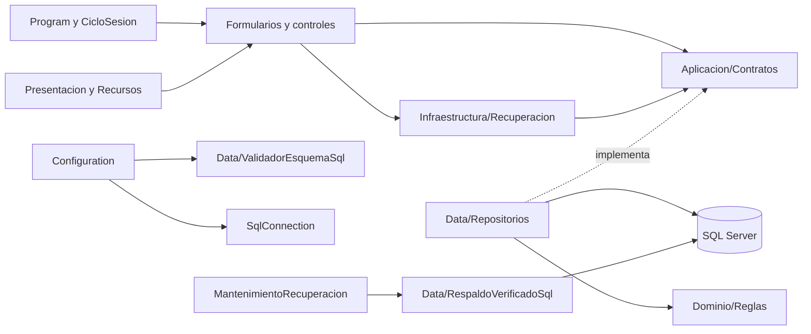

# Sabores: guía del código para la exposición

Esta guía corresponde a la reorganización del 2 de noviembre de 2026, partiendo del commit `cb342db`. No se cambió el esquema SQL ni se reinicializó la base habitual. El sistema conserva Windows Forms, SQL Server, GTQ y cobros manuales académicos.

## Cómo recorrer la solución

Las flechas resumen uso y composición, no nuevos proyectos. Se mantienen Frontend, Backend y el ejecutable de mantenimiento. El repositorio implementa los contratos; la flecha punteada representa esa relación y no una dependencia desde la interfaz hacia SQL. `UsingsGlobales.cs` agrupa imports internos de cada proyecto: no sustituye referencias del csproj ni impone aislamiento entre carpetas.

| Carpeta | Qué contiene | Qué explicar |
|---|---|---|
| Frontend/Formularios | Formularios y Designer asociados | Eventos y coordinación visual. |
| Frontend/Controles | TarjetaMesa | Composición visual reutilizable; no abre SQL directamente. |
| Frontend/Presentacion | Componentes, Iconos, DisenoFormulario, formatos y ayudas visuales | Apariencia, tamaños, accesibilidad y recursos. |
| Frontend/Recursos | PNG y licencias originales | Recursos embebidos; no se descargan al iniciar. |
| Frontend/Infraestructura/Recuperacion | Diarios protegidos y OperacionPendienteLocal | Persistencia local de solicitudes por base, usuario y GUID. |
| Backend/Dominio | Entidades, solicitudes y resultados | Datos del restaurante y abstracciones. |
| Backend/Dominio/Reglas | ReglasRestaurante, ValidacionAjuste y ValidacionCobro | Validaciones independientes de SQL y formularios. |
| Backend/Aplicacion | Servicios de instalación y preparación | Casos de uso iniciales; aún conservan parte de coordinación SQL. |
| Backend/Aplicacion/Contratos | IRepositorioRestaurante, IConsultasReportes, IGestionUsuarios, ICodigosEmergencia e IConfiguracionConexion | Capacidades y dependencias requeridas por cada pantalla. |
| Backend/Data | ValidadorEsquemaSql y RespaldoVerificadoSql | Compatibilidad de esquema y respaldo/restauración aislada. |
| Backend/Data/Repositorios | Archivos parciales RepositorioRestaurante | SQL, transacciones y reglas todavía acopladas que se conservaron para proteger atomicidad. |
| Backend/Configuration | ConfiguracionConexion y variantes, RelojGuatemala | Configuración técnica del equipo; diferente de usuarios de Sabores. |
| Backend/Seguridad | Contrasenas | Hash adaptativo y verificación compatible; nunca recupera contraseñas en texto. |
| BaseDatos | Instalación y migraciones existentes | No se ejecutan por mover archivos de C#. |
| Pruebas y Documentacion | Verificadores, evidencias y guía | Distinguir evidencia ejecutada y pendiente. |

## Nombres que conviene reconocer

Un identificador de C# es distinto de Name, Text, AccessibleName y el método del evento. `btnEntrarSistema` es la referencia usada por el código; su texto visible sigue siendo «Entrar al sistema» y su Click llama a `Entrar_Click`. No es necesario convertir todos los métodos de eventos a un nombre de botón para entenderlos: los manejadores conservados son descriptivos y están indexados.

Los prefijos acordados son btn, ct, lbl, cb, dgv, chk, pnl, pic, tlp, flp, nud, dtp, lnk y rbtn. Para controles adicionales se usan tab, tp, rtb, lst y spl. Los parámetros de métodos auxiliares pueden describir un control sin constituir otra instancia. Los controles anónimos de fábricas/bucles no necesitan convertirse en campos.

Se conservan las claves dinámicas `nav_…` y `mesa_…` por su función de identidad de navegación/instancia. Las cinco claves Name literales antiguas sin prefijo se actualizaron junto con sus pruebas. El símbolo y Name no siempre son iguales: por ejemplo, ctBuscar usa Name ctBuscarMesa para describir la búsqueda concreta. Las columnas de DataGridView mantienen sus Name/DataPropertyName del modelo; no son TextBox ni deben renombrarse con prefijos de controles.

Los anexos NombresAnterioresYNuevos.csv y ControlesYEventos.csv permiten buscar por clase, identificador, tipo, línea y evento. El catálogo es sintáctico: expresiones dinámicas y plantillas no son un árbol vivo de controles.

## Ejemplos de POO reales

| Concepto | Código | Explicación |
|---|---|---|
| Abstracción | [Restaurante.Backend/Dominio/ElementoMenu.cs:2](../../Restaurante.Backend/Dominio/ElementoMenu.cs#L2) | ElementoMenu define datos comunes y un Tipo abstracto; no se instancia directamente. |
| Herencia del dominio | [Restaurante.Backend/Dominio/Plato.cs:2](../../Restaurante.Backend/Dominio/Plato.cs#L2); [Restaurante.Backend/Dominio/Bebida.cs:2](../../Restaurante.Backend/Dominio/Bebida.cs#L2) | Plato y Bebida especializan ElementoMenu; es distinta de heredar Form. |
| Polimorfismo | [Restaurante.Backend/Data/Repositorios/RepositorioRestaurante.cs:168](../../Restaurante.Backend/Data/Repositorios/RepositorioRestaurante.cs#L168) | Una IReadOnlyList<ElementoMenu> contiene Plato/Bebida y expone su Tipo concreto. |
| Encapsulamiento | [Restaurante.Backend/Dominio/ElementoMenu.cs:15](../../Restaurante.Backend/Dominio/ElementoMenu.cs#L15) | Precio se expone con get; el importe valida cantidad antes de multiplicar. |
| Interfaz y sustitución | [Restaurante.Backend/Aplicacion/Contratos/IConsultasReportes.cs:5](../../Restaurante.Backend/Aplicacion/Contratos/IConsultasReportes.cs#L5) | Reportes pide una capacidad pequeña; pruebas pueden implementar el contrato mediante un doble. |
| Composición | [Restaurante.Frontend/Formularios/FormularioDetalleMesa.cs:16](../../Restaurante.Frontend/Formularios/FormularioDetalleMesa.cs#L16) | El formulario recibe repositorio y Mesa; no hereda de SQL ni del repositorio. |
| Objeto | [Restaurante.Frontend/Formularios/FormularioDetalleMesa.cs:161](../../Restaurante.Frontend/Formularios/FormularioDetalleMesa.cs#L161) | La solicitud reúne mesa, cliente, detalles y GUID de una operación concreta. |
| Herencia técnica | [Restaurante.Frontend/Controles/TarjetaMesa.cs:5](../../Restaurante.Frontend/Controles/TarjetaMesa.cs#L5) | TarjetaMesa combina controles y delega su acción al formulario. |
| partial | [Restaurante.Backend/Data/Repositorios/RepositorioRestaurante.Seguridad.cs:9](../../Restaurante.Backend/Data/Repositorios/RepositorioRestaurante.Seguridad.cs#L9) | Todos los parciales son una misma clase y comparten privados; no son capas diferentes. |

Cada tipo propio conserva su archivo. Los Designer son otra parte de la misma clase parcial, no una segunda clase de formulario. Los recursos de presentación siguen en Frontend. MonedaGuatemala está en Dominio: ElementoMenu ya no referencia el namespace Servicios.

## Diez recorridos para seguir en Visual Studio

### 1. Inicio

Program.Main → configuración habitual o aislada → RepositorioRestaurante → CicloSesion.Ejecutar → conexión si falta configuración → acceso. No se abre la operación diaria desde la preparación inicial.

[Restaurante.Frontend/Program.cs:7](../../Restaurante.Frontend/Program.cs#L7); [Restaurante.Frontend/Servicios/CicloSesion.cs:6](../../Restaurante.Frontend/Servicios/CicloSesion.cs#L6)

### 2. Primer administrador

btnGuardar de conexión → Guardar_Click / Ejecutar(true) → NecesitaAdministrador → asistente → btnPrepararWindows → Preparar → respaldo/restauración aislada → btnGuardar del asistente → CrearPrimerAdministrador. Una base existente no se reinicializa.

[Restaurante.Frontend/Formularios/FormularioConexion.cs:17](../../Restaurante.Frontend/Formularios/FormularioConexion.cs#L17); [Restaurante.Frontend/Formularios/FormularioPrimerAdministrador.cs:52](../../Restaurante.Frontend/Formularios/FormularioPrimerAdministrador.cs#L52); [Restaurante.Backend/Aplicacion/ServicioPreparacionInicial.cs:17](../../Restaurante.Backend/Aplicacion/ServicioPreparacionInicial.cs#L17)

### 3. Acceso y permisos

btnEntrarSistema → Entrar_Click → IniciarSesion → VerificarAcceso → objeto UsuarioAutenticado → cambio obligatorio/custodia si corresponde → principal. SesionEn revalida activo, rol y VersionSeguridad.

[Restaurante.Frontend/Formularios/FormularioAcceso.cs:57](../../Restaurante.Frontend/Formularios/FormularioAcceso.cs#L57); [Restaurante.Backend/Data/Repositorios/RepositorioRestaurante.Seguridad.cs:29](../../Restaurante.Backend/Data/Repositorios/RepositorioRestaurante.Seguridad.cs#L29); [Restaurante.Backend/Data/Repositorios/RepositorioRestaurante.Seguridad.cs:98](../../Restaurante.Backend/Data/Repositorios/RepositorioRestaurante.Seguridad.cs#L98)

### 4. Abrir una mesa

TarjetaMesa.btnAccionMesa.Click → AbrirMesa → FormularioDetalleMesa. btnAgregarProducto → Agregar_Click → SolicitudPedido → DiarioOperaciones.Ejecutar → CrearPedido → Mutacion → SQL → recarga. El primer producto crea consumo; abrir una ventana no basta.

[Restaurante.Frontend/Formularios/FormularioPrincipal.Pos.cs:6](../../Restaurante.Frontend/Formularios/FormularioPrincipal.Pos.cs#L6); [Restaurante.Frontend/Formularios/FormularioDetalleMesa.cs:143](../../Restaurante.Frontend/Formularios/FormularioDetalleMesa.cs#L143); [Restaurante.Backend/Data/Repositorios/RepositorioRestaurante.Operaciones.cs:219](../../Restaurante.Backend/Data/Repositorios/RepositorioRestaurante.Operaciones.cs#L219)

### 5. Agregar, corregir y preparar

Agregar_Click → SolicitudIncorporacion → AgregarProductoAPedido. Corregir_Click → btnAplicar / Aplicar_Click → autorización → CorregirLinea. Preparar_Click → MarcarPreparacion. Después de preparación se conserva consumo y se gestiona incidencia.

[Restaurante.Frontend/Formularios/FormularioDetalleMesa.cs:230](../../Restaurante.Frontend/Formularios/FormularioDetalleMesa.cs#L230); [Restaurante.Frontend/Formularios/FormularioCorreccionLinea.cs:37](../../Restaurante.Frontend/Formularios/FormularioCorreccionLinea.cs#L37); [Restaurante.Backend/Data/Repositorios/RepositorioRestaurante.Correcciones.cs:48](../../Restaurante.Backend/Data/Repositorios/RepositorioRestaurante.Correcciones.cs#L48)

### 6. Ajustes autorizados

btnAplicar → Aplicar_Click → SolicitudAjuste + ValidacionAjuste → Solicitar → IntentarAutorizarOperacion → AplicarAjuste → historial. La aprobación pertenece a esa solicitud, no cambia la sesión del Mesero.

[Restaurante.Frontend/Formularios/FormularioAjuste.cs:19](../../Restaurante.Frontend/Formularios/FormularioAjuste.cs#L19); [Restaurante.Frontend/Formularios/FormularioAutorizar.cs:140](../../Restaurante.Frontend/Formularios/FormularioAutorizar.cs#L140); [Restaurante.Backend/Data/Repositorios/RepositorioRestaurante.Autorizacion.cs:35](../../Restaurante.Backend/Data/Repositorios/RepositorioRestaurante.Autorizacion.cs#L35)

### 7. Cobro y comprobante

btnRevisarCobro → Facturar_Click → RevisarCuenta → FormularioCobro. btnConfirmar → validación visual → SolicitudCobro → DiarioOperaciones → RegistrarCobro → ValidacionCobro → transacción → comprobante académico si confirmado. Tarjeta incierta mantiene cuenta pendiente.

[Restaurante.Frontend/Formularios/FormularioDetalleMesa.cs:188](../../Restaurante.Frontend/Formularios/FormularioDetalleMesa.cs#L188); [Restaurante.Frontend/Formularios/FormularioCobro.cs:169](../../Restaurante.Frontend/Formularios/FormularioCobro.cs#L169); [Restaurante.Backend/Dominio/Reglas/ValidacionCobro.cs:7](../../Restaurante.Backend/Dominio/Reglas/ValidacionCobro.cs#L7); [Restaurante.Backend/Data/Repositorios/RepositorioRestaurante.Cobros.cs:9](../../Restaurante.Backend/Data/Repositorios/RepositorioRestaurante.Cobros.cs#L9)

### 8. Cierre e incidencias

btnAplicar de gestión → SolicitudGestionMesa o conciliación → autorización → GestionarMesa / ConciliarTarjeta. Incidencia posterior → ResolverIncidencia por Gerente/Admin: cobro completo, pérdida o condonación. Mesa física y saldo pendiente son conceptos distintos.

[Restaurante.Frontend/Formularios/FormularioGestionMesa.cs:101](../../Restaurante.Frontend/Formularios/FormularioGestionMesa.cs#L101); [Restaurante.Backend/Data/Repositorios/RepositorioRestaurante.Cobros.cs:130](../../Restaurante.Backend/Data/Repositorios/RepositorioRestaurante.Cobros.cs#L130); [Restaurante.Backend/Data/Repositorios/RepositorioRestaurante.Correcciones.cs:104](../../Restaurante.Backend/Data/Repositorios/RepositorioRestaurante.Correcciones.cs#L104)

### 9. Recuperación de acceso

lnkRecuperar → RecuperarClave_Click → disponibilidad → FormularioRecuperarClave → btnRecuperar → administrador/código válido → resultado consultable por GUID/recibo. Sin mecanismo, mantenimiento técnico autorizado con respaldo: no hay acceso fijo público.

[Restaurante.Frontend/Formularios/FormularioAcceso.cs:19](../../Restaurante.Frontend/Formularios/FormularioAcceso.cs#L19); [Restaurante.Frontend/Formularios/FormularioRecuperarClave.cs:91](../../Restaurante.Frontend/Formularios/FormularioRecuperarClave.cs#L91); [Restaurante.Backend/Data/RespaldoVerificadoSql.cs:6](../../Restaurante.Backend/Data/RespaldoVerificadoSql.cs#L6)

### 10. Reportes

Navegación Reportes → FormularioReportes_Shown / btnConsultar → CargarAsync → IConsultasReportes → consultas protegidas → dgvVentas/dgvPlatos/dgvPedidos/dgvOperaciones. No sumar cobros, comprobantes y ajustes como si fueran el mismo ingreso.

[Restaurante.Frontend/Formularios/FormularioReportes.cs:41](../../Restaurante.Frontend/Formularios/FormularioReportes.cs#L41); [Restaurante.Frontend/Formularios/FormularioReportes.cs:84](../../Restaurante.Frontend/Formularios/FormularioReportes.cs#L84); [Restaurante.Backend/Aplicacion/Contratos/IConsultasReportes.cs:5](../../Restaurante.Backend/Aplicacion/Contratos/IConsultasReportes.cs#L5)

## Seguridad y recuperación que no deben simplificarse

- Mesero crea pedidos, cobra y puede crear clientes; no edita clientes existentes ni administra usuarios.
- Gerente vende y administra operación; Administrador además gestiona usuarios/roles y conexión SQL.
- `ExigirSesion(requiereGerencia: true)` exige Gerente o Admin. Para exclusividad de Admin se usa `SesionEn(administrador: true)`. El booleano ya no se llama administrador cuando realmente exige gerencia.
- `GuardarUsuario` protege al último administrador activo. Cambios de rol/desactivación invalidan sesiones mediante VersionSeguridad.
- `Mutacion` conserva una transacción y orden de bloqueos. GUID + tipo + hash + propietario permiten recuperar el resultado sin duplicar consumo/cobro. Los archivos parciales de Data siguen compartiendo ese mecanismo.
- El diario local conserva DPAPI, rutas, formato y vínculo base/usuario/GUID. Mover su clase de namespace no cambia los miembros JSON persistidos.
- Descuento/cortesía son ajustes antes del cobro. No se cambia precio histórico ni se usa cancelación para ocultar consumo.
- Comprobante académico, GTQ/Q, efectivo y tarjeta manual; sin SAT, FEL ni integración bancaria.

## Distinguir los elementos al exponer

| Elemento | Ejemplo | Cómo identificarlo |
|---|---|---|
| Campo | _pedido en FormularioDetalleMesa | Vive en la instancia del formulario. |
| Propiedad | Precio de ElementoMenu | Tiene acceso get; no es un TextBox. |
| Parámetro | pedidoId de RevisarCuenta | Entrada de una invocación concreta. |
| Variable local | solicitud en Agregar_Click | Vive en el bloque/método. |
| Control | btnAgregarProducto | Button que recibe interacción. |
| Name | ctBuscarMesa | Identidad de control en ejecución; distinta de su texto. |
| Text | Entrar al sistema | Rótulo que ve la persona. |
| Evento | Click | Notificación del control. |
| Manejador | Agregar_Click | Método que coordina la acción del evento. |
| Columna SQL | PedidoId de Facturas | Dato persistente definido por script SQL; no variable C#. |
| Parámetro SQL | @p | Valor enviado a una consulta parametrizada; distinto del nombre de columna. |

## Exposición sugerida para cinco integrantes

1. Interfaz y recursos: Designer, nombres, eventos, TarjetaMesa, iconos y accesibilidad.
2. Dominio y POO: ElementoMenu, Plato/Bebida, solicitudes y reglas.
3. Datos: repositorio, consultas, transacciones, versionado y comprobantes.
4. Seguridad: instalación, roles, contraseñas, autorizaciones y recuperación.
5. Verificación y operación: cobro manual, incidencias, pruebas y límites.

Todos deben explicar el recorrido de un mismo pedido completo. Practiquen localizar el método con Ctrl+T y consultar referencias con Shift+F12. No memoricen solo números de línea: cambian al editar.

| Pregunta del docente | Respuesta concreta |
|---|---|
| ¿Dónde comienza? | Program.Main compone dependencias y CicloSesion dirige las pantallas. |
| ¿Qué aporta una interfaz? | Reportes solo recibe IConsultasReportes; Usuarios IGestionUsuarios; códigos ICodigosEmergencia. |
| ¿Se separó todo el negocio de SQL? | No. Se extrajeron validaciones y capacidades pequeñas; las mutaciones críticas permanecen juntas para preservar atomicidad. |
| ¿Qué es partial? | Una clase distribuida en archivos; Designer y código son partes de esa misma clase. |
| ¿Dónde está la clase abstracta? | ElementoMenu; Plato/Bebida implementan Tipo. |
| ¿Ocultar un botón es seguridad? | No; el Backend vuelve a comprobar sesión y permisos. |
| ¿Qué hace la recuperación de operaciones? | Reusa la solicitud/GUID y consulta su resultado, no repite un cobro nuevo. |
| ¿Por qué puede haber mesa libre y deuda? | Una incidencia conserva consumo pendiente aunque la mesa pueda reutilizarse. |
| ¿Por qué aparecen iconos ahora? | Se reutilizan PNG embebidos y la tarjeta tiene PictureBox explícito; la franja ajusta su altura. |
| ¿Qué no está certificado? | Todos los DPI/monitores, accesibilidad completa, edición de cada Designer y operación compartida de producción. |

## Lectura de los anexos

Movimientos.csv relaciona rutas; NombresAnterioresYNuevos.csv relaciona símbolos; ControlesYEventos.csv separa Name/Text/evento; ClasesYContratos.csv y MiembrosDelCodigo.csv sitúan declaraciones por línea. Son índices estáticos: las llamadas por nombre pueden requerir resolver sobrecargas con Visual Studio. No incluyen miembros heredados del framework ni datos de SQL.

