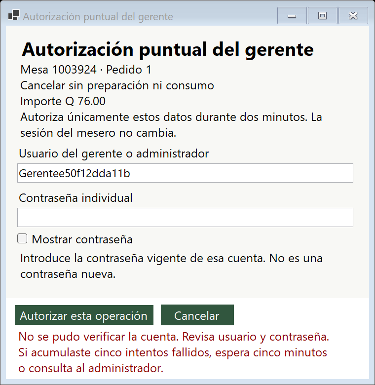
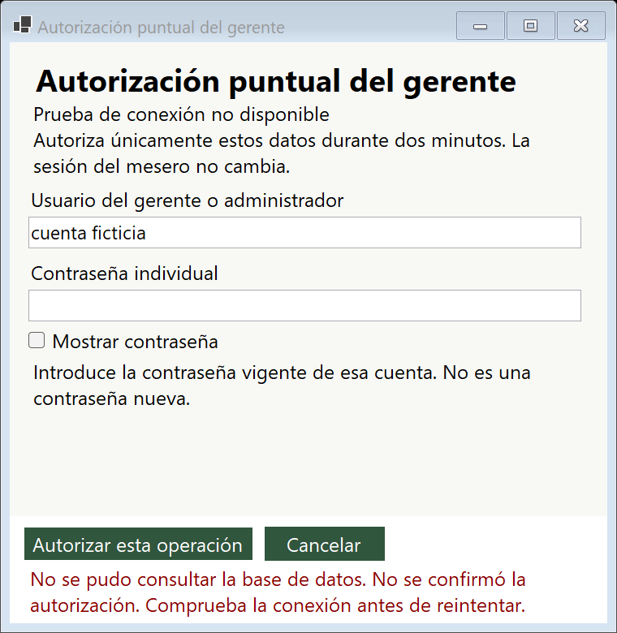

# Corrección de rechazos de autorización

## Diagnóstico

La captura muestra `autorizador = null`. `VerificarAcceso` devuelve ese resultado si la cuenta no existe, está inactiva, está temporalmente bloqueada o su contraseña no coincide; también rechaza entradas fuera de los límites. No es posible determinar cuál ocurrió en la cuenta real a partir de la captura. La comparación del usuario usa `WHERE Usuario=@u` y depende de la intercalación de SQL Server; no se atribuye el rechazo a escribir Admin con mayúscula.

El método anterior agrupaba estos resultados, el cambio obligatorio y el rol insuficiente en una `UnauthorizedAccessException`. El diálogo anterior capturaba posteriormente la excepción. Por tanto, la captura del depurador por sí sola no demuestra un cierre de la aplicación. No se cambió la configuración del depurador.

## Corrección

- El diálogo utiliza `IntentarAutorizarOperacion` y un resultado tipado para los rechazos esperados. El método anterior se conserva como adaptador compatible para consumidores existentes y pruebas de servicio; ese adaptador sigue lanzando una excepción si se rechaza la solicitud.
- Credenciales incorrectas, cuenta inexistente, inactiva y bloqueo comparten un mensaje seguro. Después de verificar la contraseña se distingue cambio obligatorio y rol insuficiente.
- Se comprueban sesión vigente, identificador, acción, motivo y versión del pedido; se conserva la vinculación mediante hash a los datos originales. La autorización caduca a los dos minutos y el consumo vuelve a comprobar rol, versión de seguridad, solicitante y solicitud.
- Antes de comprobar nuevamente credenciales se revoca, en una transacción confirmada, la aprobación anterior no consumida del mismo solicitante y operación. Cancelar también intenta revocarla. Un rechazo no ejecuta la gestión comercial.
- El formulario valida campos vacíos, impide doble envío, permite mostrar la contraseña, conserva el usuario y limpia y vuelve a ocultar la contraseña al terminar. No exige el mínimo de una contraseña nueva para autenticar.
- Las actualizaciones posteriores a la comprobación asíncrona se ejecutan explícitamente en el hilo de interfaz. Esto evita que el control de contraseña pierda su valor durante un reintento.
- Un fallo SQL no se presenta como contraseña incorrecta. Si al cancelar no se puede confirmar la revocación, se informa de esa incertidumbre; no se ejecuta la gestión. Si SQL ya registró la operación se indica recuperar el identificador original, sin duplicarla.

## Uso

1. Introduce el usuario y la contraseña vigente del gerente o administrador.
2. Si se rechaza, revisa el mensaje, corrige la contraseña y vuelve a autorizar en la misma ventana. Cinco intentos fallidos bloquean temporalmente la cuenta durante cinco minutos.
3. Si se exige cambiar la contraseña, hazlo desde Iniciar sesión. No se restablece automáticamente.
4. Si cambió la cuenta o el pedido, actualiza la información antes de solicitar otra aprobación.
5. Usa Cancelar para abandonar. No repitas una gestión cuyo resultado SQL sea incierto: recupérala desde Inicio con su identificador original.

## Evidencias y reproducción

Se aprobaron 34 comprobaciones específicas de autorización y 72 de regresión de roles, instalación, concurrencia y controles reales. Se utilizaron exclusivamente bases `Restaurante_Pruebas_*` y cuentas ficticias. No se modificaron usuarios, contraseñas, conexión ni esquema de RestauranteDB.

Desde la raíz del repositorio:

```powershell
& ./restaurante2/Pruebas/Roles/VerificarRoles.ps1 -SoloAutorizacion -RutaArtefactos .codex-build/AutorizacionArtefactos
& ./restaurante2/Pruebas/Roles/VerificarRoles.ps1 -RutaArtefactos .codex-build/AutorizacionArtefactos
dotnet build restaurante2/Restaurante.sln -c Release --artifacts-path .codex-build/AutorizacionArtefactos --no-restore -m:1 -nr:false
```

El verificador conserva las bases aisladas para diagnóstico y no cambia el perfil habitual. Los registros están en [EvidenciasAutorizacion/verificacion.txt](EvidenciasAutorizacion/verificacion.txt) y [EvidenciasRoles/verificacion.txt](EvidenciasRoles/verificacion.txt). El verificador visual instala su contexto WinForms en el hilo de pruebas después de abrir cada formulario.

Capturas reales con contraseña vacía y cuentas ficticias:





También se verificó que mensaje y botones permanecen visibles con tamaños de ventana 1280 × 720 y 1366 × 768. Esto no certifica todos los escalados DPI ni sustituye una revisión física de cada monitor.

Debug y Release compilaron sin errores en una carpeta de salida aislada: la aplicación abierta en Visual Studio bloqueaba los binarios Debug habituales y no se cerró su sesión. NuGet emitió NU1900 porque no pudo consultar su índice de vulnerabilidades; no se desactivó esa comprobación.

## Respaldo y recuperación

Rama de trabajo: `correcciones/rechazos-autorizacion-20261027`.

Respaldo previo: `respaldo/antes-rechazos-autorizacion-20261027`, commit `f488700`.

Para usar el código anterior, detén la depuración, preserva cualquier trabajo posterior y cambia a la rama de respaldo; recompila antes de abrir. No se requiere restaurar ni migrar la base habitual para esta corrección. No se hizo push ni se mezcló con main.

Para cargar la corrección actual en Visual Studio, detén la instancia anterior con Shift+F5 y vuelve a compilar y ejecutar el proyecto Frontend con F5.
