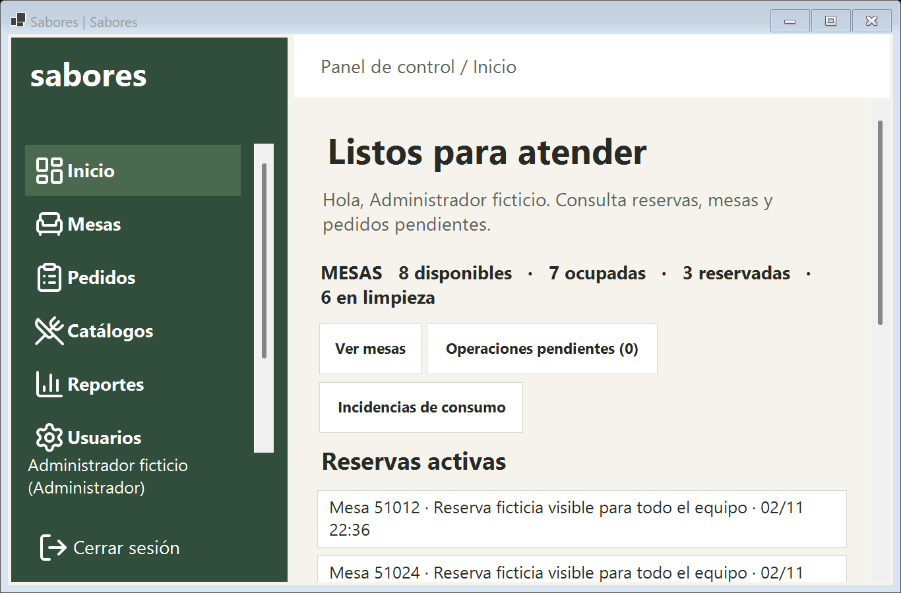
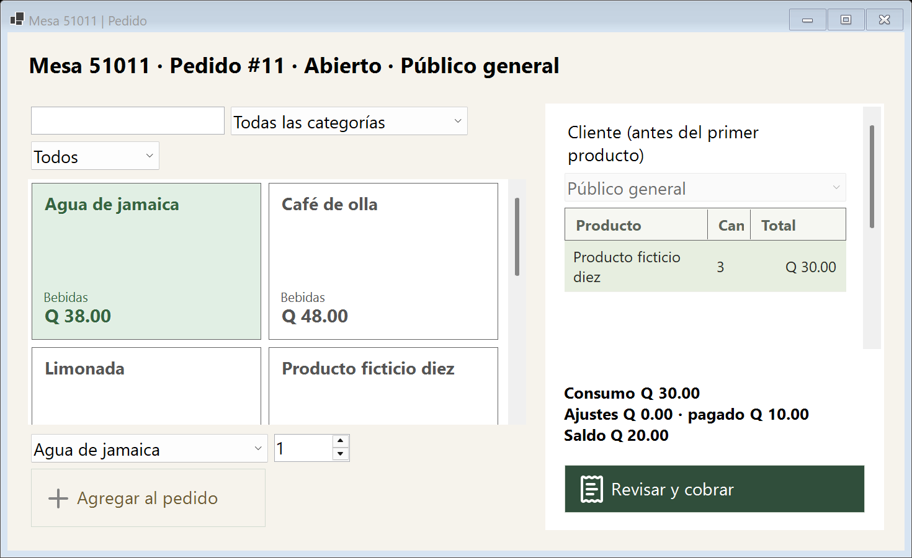
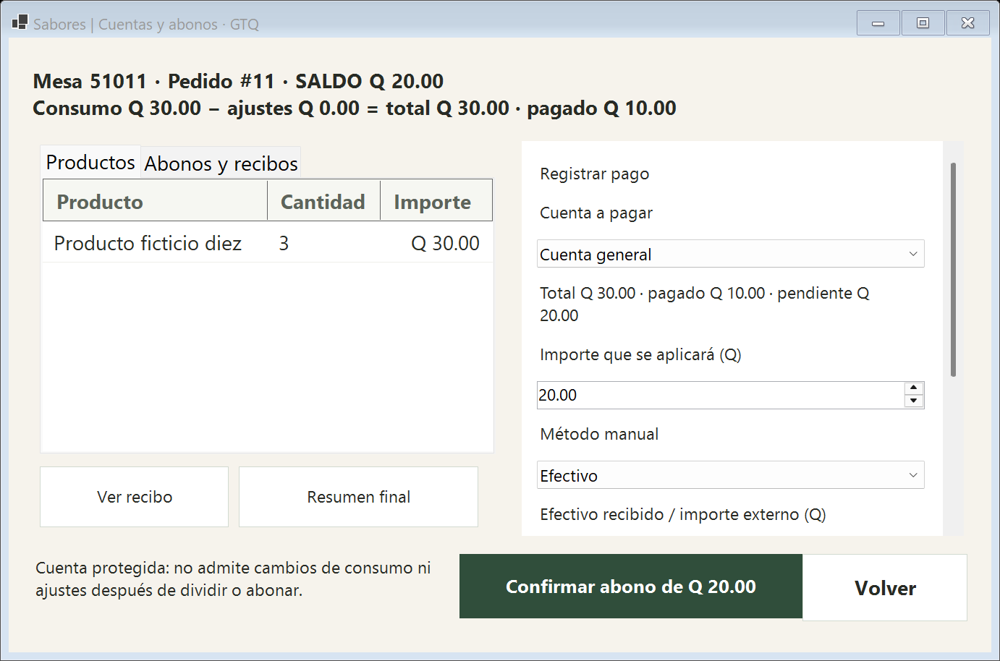
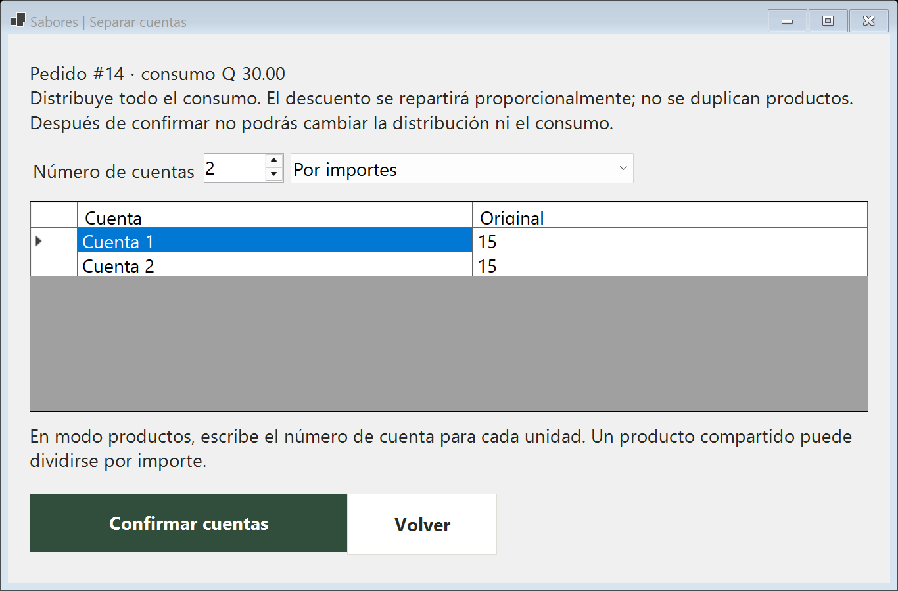
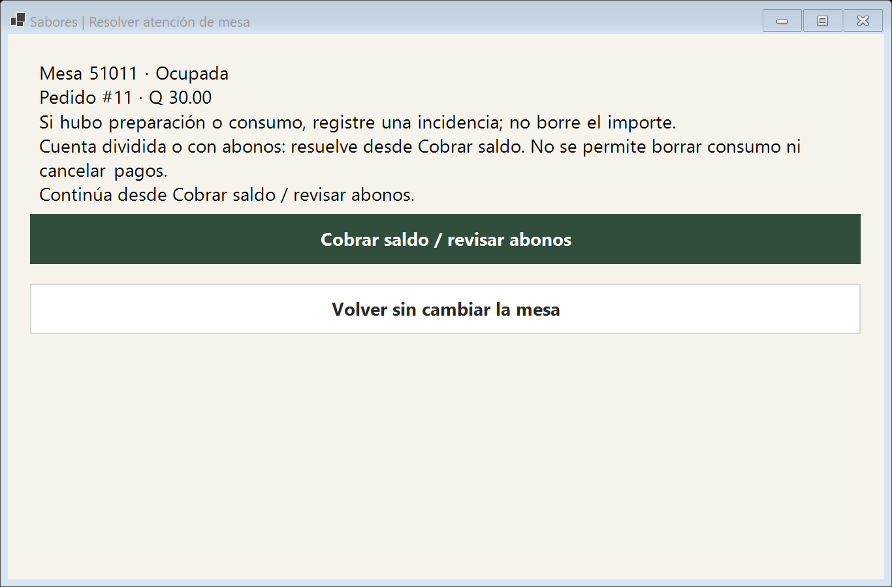
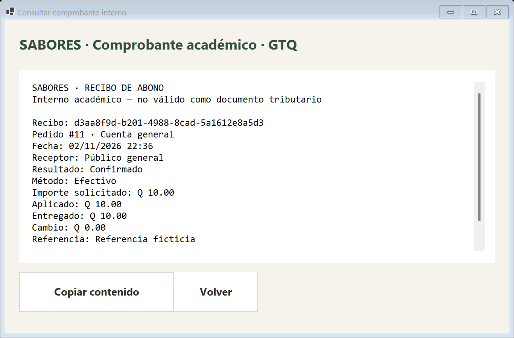

# Entrega de operación integral de Sabores

Se implementaron las mejoras en la rama **mejoras/operacion-cuentas-20261102**, conservando Windows Forms, Designer, SQL Server y separación de capas. Se habilitó el esquema 009 en la base habitual después del respaldo, restauración aislada y ensayo verificados.

## Qué cambió

- Inicio prioriza reservas, estados de mesas y pendientes. Las reservas son visibles para todos los roles operativos.
- El catálogo separa nombre, categoría y precio; la comanda tiene selección visual y resumen de consumo, ajustes, pagos y saldo junto a Revisar y cobrar.
- El cierre explica consecuencias y ofrece únicamente acciones compatibles. No usa cancelaciones para ocultar consumo o dinero.
- Descuentos porcentuales de 5 a 50, promoción configurable de cliente frecuente y cortesía explícita del 100 %, con autorización e historial.
- División por importes o unidades completas; abonos en efectivo y tarjeta manual; cambio separado del importe aplicado.
- Recibos individuales por abono y un resumen final del pedido. Una tarjeta incierta requiere conciliación antes de volver a cobrar.

## Verificaciones

266 comprobaciones entre operación integral (57), reservas (67), auditoría (74), regresión general (65) y referencias (3). Compilaciones Debug y Release sin errores ni advertencias. Se probó respaldo, restauración real, integridad, repetición de 009 y actualización 8 → 9 en bases aisladas antes del destino.

Las capturas son renderizaciones de formularios reales con datos ficticios, a DPI observado 168 (175 %). Se permite desplazamiento cuando el contenido supera la ventana. No se certificaron todos los DPI, Designer de Visual Studio ni un recorrido manual completo de terminales externas.

## Cómo comenzar

1. Inicie sesión con su usuario habitual y consulte Inicio.
2. Abra una mesa/pedido y use Revisar y cobrar.
3. Si necesita beneficio, aplíquelo antes de separar o abonar.
4. Puede separar la cuenta antes del primer pago, o usar Cuenta general y registrar abonos sucesivos.
5. Revise los recibos y el saldo. La mesa pasa a limpieza al liquidar todo el pedido.

La promoción frecuente comienza inactiva; Gerente/Administrador configura visitas mínimas, porcentaje y vigencia. No se inventó un umbral activo ni se aplican descuentos automáticamente.

## Límites que debe conocer

Los ajustes y las divisiones se definen antes del cobro. Una cuenta dividida o con pagos confirmados/inciertos queda protegida contra cambios de consumo, nuevos descuentos, cancelación o cierre por incidencia. No se incluyeron devoluciones ni reversión de divisiones. Las promociones abarcan la cuenta completa y no se acumulan; no hay campañas por producto/categoría. Para compartir una unidad use reparto por importe. Se mantienen GTQ, pagos manuales y documentos académicos sin SAT/FEL ni banco.

## Documentación y recuperación

- [Manual de uso](../../Documentacion/ManualUsuario/OperacionIntegral009.md).
- [Clases, controles, permisos y ejemplos para exponer](../../Documentacion/EstructuraCodigo/OperacionIntegral009.md).
- [Resultados y reproducción](README.md).
- [Migración y recuperación](../../BaseDatos/Operacion009.md).
- [Activación de la base habitual](Activacion_20261102.md).

Punto de respaldo: **respaldo/antes-operacion-integral-20261102-928ef17**. Se conservaron ZIP, bundle y respaldo SQL fuera del repositorio. No basta volver al ejecutable anterior después de migrar: requiere una copia restaurada compatible, con revisión de movimientos posteriores. No se publicó ni mezcló con main.

## Capturas

