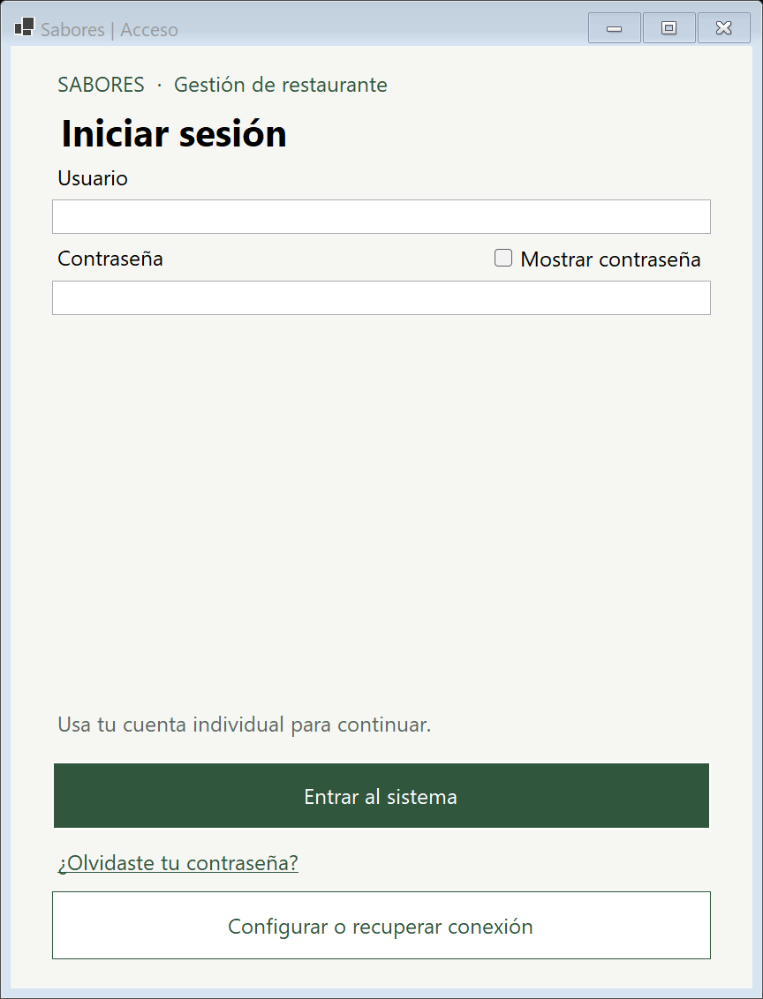
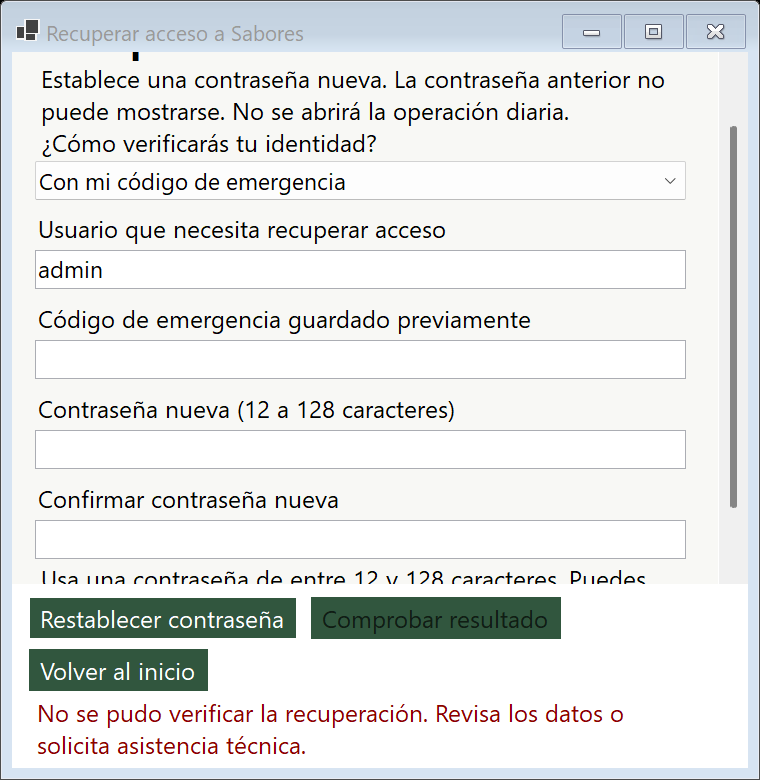

# Implementación de recuperación de contraseñas

## Alcance

Windows Forms y SQL Server, archivos Designer y un archivo por clase. Se conserva el formulario `FormularioRecuperacion` de operaciones pendientes; las contraseñas usan `FormularioRecuperarClave`. No hay integración de correo/SMS, SAT/FEL ni bancos.

Los cambios locales previos (capturas de evidencias) quedaron preservados en `ca2ca77`; la rama de respaldo apunta a ese commit. No se publicaron cambios ni se mezcló con main. La implementación se probó en bases aisladas; no se migró RestauranteDB ni se restablecieron cuentas habituales.

## Diseño aplicado

- `RepositorioRestaurante.Recuperacion`: operaciones separadas del mantenimiento general de usuarios. Reautenticación administrativa, resultado de rechazo tipado y validación dentro de transacción serializable con el bloqueo de seguridad existente.
- `ResultadoRecuperacion`: resultado seguro, sin contraseña ni verificador.
- Migración 006 aditiva: identidad GUID de instalación, códigos por usuario y resultados de recuperación. El funcionamiento previo admite esquema 5; la recuperación requiere la extensión 6 y no migra automáticamente. La validación general acepta 5 y 6 y exige la presencia de la versión base 5.
- Código de 32 bytes aleatorios, representado como 64 caracteres hexadecimales. Se almacena SHA-256 de instalación, usuario y secreto de alta entropía; las contraseñas conservan PBKDF2-SHA256, sal aleatoria e iteraciones existentes. El código requiere confirmación de custodia, se consume una vez y se invalida por cambio de versión de seguridad.
- La recuperación con otro Administrador exige un autorizador distinto de la cuenta objetivo, activo, sin cambio obligatorio ni bloqueo vigente. Rol y versión se revalidan antes de escribir. La clave nueva la introduce el titular y no se establece como temporal en ese flujo.
- Una recuperación confirma en la misma transacción la contraseña, incremento de versión, reinicio de bloqueo de acceso, consumo de código, revocación de aprobaciones no consumidas del usuario como solicitante/autorizador, auditoría y resultado de operación.
- Cinco fallos de código producen una pausa de cinco minutos independiente del bloqueo de acceso. No se registra el valor introducido. Los mensajes no distinguen cuenta inexistente, inactiva o código incorrecto.
- El identificador de operación y una prueba aleatoria de consulta permiten recuperar el resultado después del consumo. SQL conserva solo el hash de la prueba. La interfaz mantiene el comprobante cifrado con DPAPI por perfil Windows y destino; no incluye credenciales. Los errores inciertos bloquean otro envío hasta consultar SQL. No se reutiliza el diario de cobros para esta operación de seguridad.
- La herramienta de mantenimiento está en un proyecto distinto que no referencia el Frontend. Requiere sysadmin, confirmación interactiva, responsable y motivo. Respalda y restaura antes del restablecimiento; exige cambiar la contraseña temporal e invalida sesiones/códigos/aprobaciones. Su API de código no constituye una frontera frente a un administrador SQL: esa persona ya puede modificar directamente los datos.
- Las respuestas asíncronas se publican al hilo de Windows Forms sin actualizar controles destruidos. La regresión también corrigió el retorno del cambio obligatorio en el acceso y la carrera de cierre de la autorización puntual.

## Verificación reproducible

Desde la raíz Git, con .NET 8, SQL LocalDB y sqlcmd:

```powershell
& ./restaurante2/Pruebas/Roles/VerificarRoles.ps1 -SoloRecuperacion -RutaArtefactos .codex-build/Recuperacion
& ./restaurante2/Pruebas/Roles/VerificarRoles.ps1 -RutaArtefactos .codex-build/Recuperacion
& ./restaurante2/Pruebas/Roles/VerificarRoles.ps1 -SoloAutorizacion -RutaArtefactos .codex-build/Recuperacion
dotnet build restaurante2/Restaurante.sln -c Debug --artifacts-path .codex-build/Recuperacion --no-restore -m:1 -nr:false
dotnet build restaurante2/Restaurante.sln -c Release --artifacts-path .codex-build/Recuperacion --no-restore -m:1 -nr:false
```

El script crea cuentas y bases `Restaurante_Pruebas_*`; las pruebas de recuperación verifican una restauración aislada con CHECKDB antes de migrar. El mecanismo excepcional se ejecuta únicamente en esa base ficticia. Los registros y capturas reales están en [EvidenciasRecuperacion](EvidenciasRecuperacion/verificacion.txt); no contienen contraseñas o códigos.

La suite específica incluye 61 comprobaciones y conserva un pedido y un comprobante de venta manual GTQ durante las recuperaciones. La regresión general incluye 72 comprobaciones y la suite de autorizaciones, 34. Los totales y resultados se encuentran en sus archivos `verificacion.txt`. Debug y Release se compilan en una carpeta aislada para no interferir con una instancia abierta del programa.





Incluye pruebas de código inválido, sin confirmar, de otra identidad, revocado, consumido y concurrente; roles, cuenta inactiva y cambio obligatorio; consulta con recibo válido e inválido; cancelación; revocación de aprobaciones; SQL desconectado; recuperación del comprobante al reabrir; intervención con cambio obligatorio; campos, reintento y controles reales. Las pruebas previas de roles y autorizaciones se ejecutan por separado para comprobar regresiones.

## Límites operativos

- Poseer un código permite recuperar su cuenta. No sustituye verificar físicamente la identidad cuando otro Administrador asiste.
- El comprobante local depende del perfil Windows. Si se pierde o se daña, un técnico debe comprobar el resultado SQL antes de volver a intervenir.
- Una restauración externa que copie toda la base también copia su identidad y verificadores. Debe revocar códigos y establecer una nueva identidad en clones. Las copias realizadas por la herramienta ya hacen ambas cosas.
- No se certifican todos los monitores/DPI por comprobar tamaños de ventana 1280 × 720 y 1366 × 768. Las capturas provienen de controles WinForms reales, no de una maqueta.
- SQL remoto exige rutas de archivos accesibles por el motor. El procedimiento conserva respaldos y clones y no realiza limpieza automática ni sobrescribe destinos existentes.
- La operación diaria debe detenerse durante actualización o mantenimiento. No se ensayó una intervención sobre la instalación habitual.
- La restauración de NuGet puede emitir NU1900 si su índice de vulnerabilidades no está accesible. No se desactivó la auditoría de paquetes.

Uso y recuperación del código anterior: [guía de recuperación](../Documentacion/ManualUsuario/Recuperar_acceso.md).
