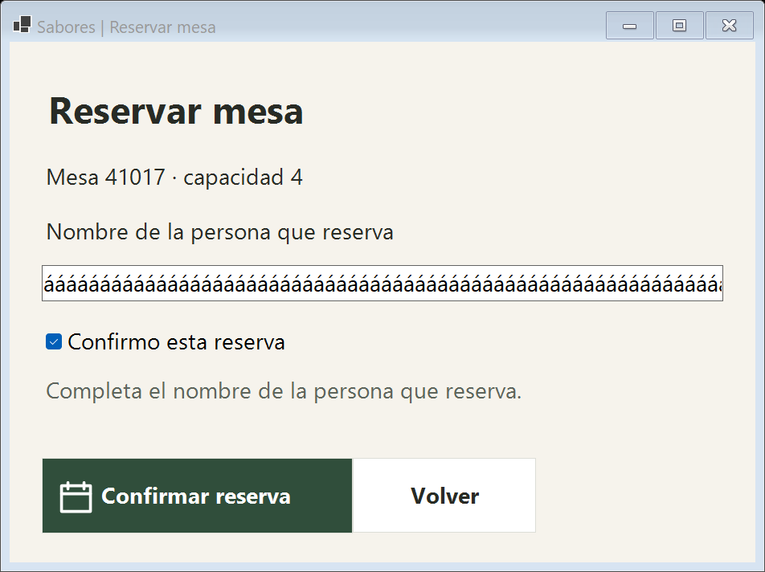
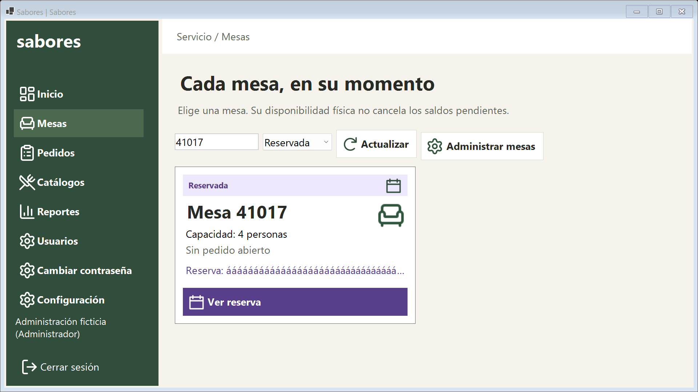
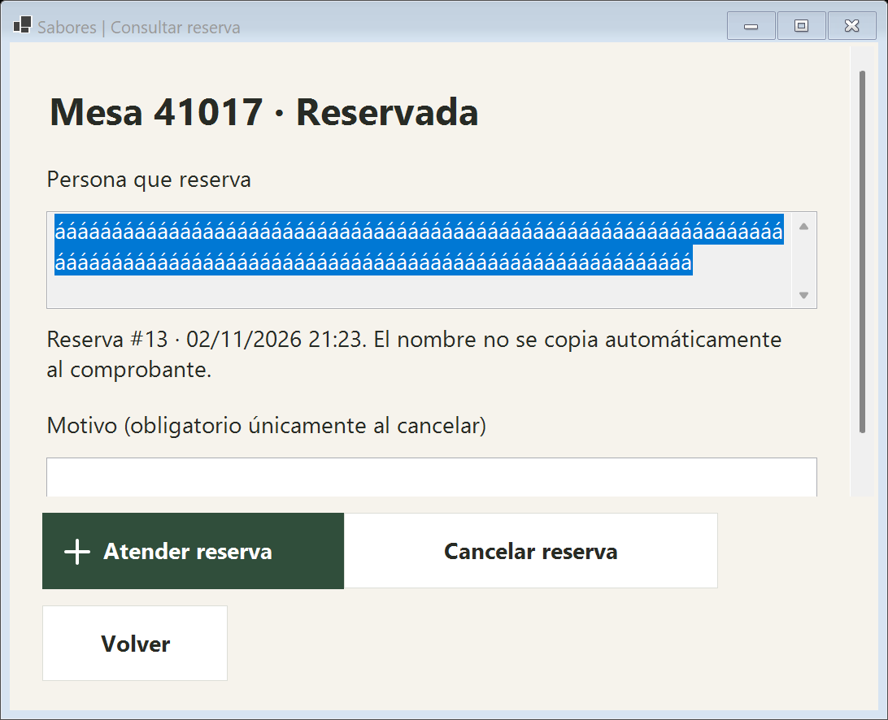

# Entrega: reservas de mesas de Sabores

## Diagnóstico y cambio

Antes, Reservada era principalmente un estado de la mesa: no había una entidad con titular, versión, operación y cierre que permitiera distinguir la reserva del pedido. La pantalla mostraba una leyenda general de colores. Ahora la reserva es un registro propio y el flujo separa apartar, atender con el primer consumo y cancelar sin consumo.

Se conservan Windows Forms, Designer, SQL Server, las capas existentes, los iconos del proyecto y las reglas de cobro. El nombre completo puede consultarse sin alterar el cliente de facturación. Verde, amarillo, rojo y morado conservan sus estados escritos para no depender solo del color.

## Política aprobada

Mesero, Gerente y Administrador reservan y atienden; Empleado legado se mantiene compatible. Mesero cancela con autorización puntual de Gerente/Administrador; estos últimos cancelan directamente. Siempre hay motivo e historial. Agregar el primer producto vincula el pedido; abrir la ventana no crea consumo. No se permite cancelar una reserva para borrar pedidos o documentos.

## Resultados y documentación

- [67 comprobaciones específicas, 65 generales y 74 de auditoría; límites y reproducción](README.md).
- [Manual paso a paso](../../Documentacion/ManualUsuario/Reservas_20261102.md).
- [Mapa de clases, controles y recorrido para exponer](../../Documentacion/EstructuraCodigo/Reservas_20261102.md).
- [Script, activación pendiente y recuperación](../../BaseDatos/Reservas008.md).
- [Migración SQL 008](../../BaseDatos/Migracion_008.sql).

Las reservas anteriores sin titular no se alteran y requieren revisión responsable; no se inventaron datos. A 1366 × 768 con 175 % se necesita desplazamiento y persiste el recorte de la descripción larga del encabezado existente. No se verificaron otros DPI ni apertura en Designer. Los controles y formularios sí se ejecutaron; Debug y Release compilan sin errores ni advertencias.

## Capturas de controles reales con datos ficticios

## Respaldo del código y estado de publicación

- Rama de trabajo: mejoras/reservas-mesas-20261102.
- Base inicial: 2c2dbde6569ded2b7d952e4378ecd829bcd17b39, con árbol limpio al iniciar.
- Tag: respaldo/antes-reservas-20261102-2c2dbde.
- Carpeta externa: C:/Users/DaniveK/.codex/visualizations/2026/10/25/01a174b9-7292-7271-95db-4bea2c57c13d/Reservas20261102.
- Archivo codigo-inicial-2c2dbde.zip, SHA256 16866319B728F5C14971F93D084827D5441D69FEEAB5AB29629BDBAF48F9B3F1.
- Archivo historial-previo.bundle, SHA256 D9EFD5BC01D6A201EDA587ACAECEC838A4BEC27DB07A5361F66F7A9AA4AF349E; git bundle verify aprobó historial completo.

Los commits de esta rama son locales. No se publicó ni mezcló con main. No se migró ni se cambió la conexión de RestauranteDB. El prompt exige autorización específica después de presentar script probado y recuperación; ambos están listos en el documento de activación. Mientras el destino siga en esquema 7, Reservar mesa aparece deshabilitado con explicación.
